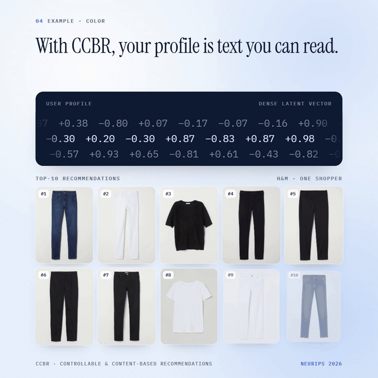

# CCBRNeurIPS2026

Code for *Controllable and Content-Based Recommendations* (CCBR, NeurIPS 2026) on
H&M, MovieLens-20M and the Million Song Dataset (MSD).

**Paper:** [arXiv:2607.20938](https://arxiv.org/pdf/2607.20938)

<p align="center">
  
  <br>
  <a href="assets/CCBR-NeurIPS2026-teaser.mp4?raw=true">Download the full teaser video</a> (1:32, 7 MB, with sound)
</p>

| Folder | Contents |
|---|---|
| `autoencoder_training/` | collaborative filtering backbones (training, evaluation, tuning) |
| `experiments/HM/` | CCBR on H&M |
| `experiments/ML-20M/` | CCBR on ML-20M |
| `experiments/MSD/` | CCBR on MSD, plus LLM tag extraction and summary edits |
| `summary_generation/` | item descriptions and user summaries (VLM/LLM) |

Each `experiments/` folder contains the MF item embeddings (`mf_upgraded.py`), the
two CCBR training stages (`main_first_stage.py`, `main_ddp_*`), the TEARS baseline
(`main_tears.py`) and the controllability evaluation (`intervene_*`).

## Setup

```bash
pip install torch numpy tqdm optuna
pip install transformers sentence-transformers peft scipy matplotlib
```

## Data

The preprocessed splits and the LLM-edited summaries used in the controllability
experiments are zipped in `data/`:

```bash
cd data
unzip hm/hm.zip
cat ml-20m/ml-20m.zip.part-* > ml-20m.zip && unzip ml-20m.zip && rm ml-20m.zip
cat msd/msd.zip.part-* > msd.zip && unzip msd.zip && rm msd.zip
unzip hm/hm_interventions.zip -d hm
unzip ml-20m/ml20m_interventions.zip -d ml-20m
unzip msd/msd_interventions.zip -d msd
```

| Dataset | Items | Users (train / valid / test) |
|---|---|---|
| H&M | 1,943 | 68,201 / 1,000 / 1,000 |
| ML-20M | 11,355 | 125,269 / 5,000 / 5,000 |
| MSD | 31,046 | 156,188 / 5,000 / 5,000 |

`data/readme.md` describes every file. The original datasets are subject to their
own licenses.

## Backbones

Run from the repository root:

```bash
python autoencoder_training/autoencoders.py --dataset ml20m --model-type ease
python autoencoder_training/autoencoders.py --dataset msd --model-type edlae_lowrank --tune
```

| `--model-type` | Name in the paper |
|---|---|
| `ease` | EASE |
| `edlae_full` | EDLAE (FR) |
| `edlae_lowrank` | EDLAE (LR) |
| `linear` | Linear-DAE |
| `deep` | Multi-DAE |
| `mult_vae` | Multi-VAE |
| `macrid_vae` | MacridVAE |

Weights are saved to `checkpoints/<dataset>/`. `ease` and `edlae_full` save the full
item × item matrix, which `experiments/<dataset>/factorize.py` factorises by SVD
before CCBR training. `--help` lists all options.

```bash
python autoencoder_training/autoencoders.py --dataset hm --model-type ease
python experiments/HM/factorize.py --checkpoint-dir checkpoints/hm --models ease --rank 1024
# -> checkpoints/hm/enc_ease_svd.pt, checkpoints/hm/dec_ease_svd.pt
```

## Running CCBR

All commands run from the repository root, and every default path points to
`data/<dataset>/` and `checkpoints/<dataset>/`. Stage 1 runs on one GPU; stage 2
and TEARS use `torchrun` (the examples use 4 GPUs). The H&M pipeline:

```bash
# Stage 1: fine-tune the text encoder on the summaries -> results/<run>/best_joint.pt
python experiments/HM/main_first_stage.py

# Stage 2: align the text encoder with a backbone -> results_hm/<run>/
torchrun --nproc_per_node=4 experiments/HM/main_ddp_ae.py \
    --base-path results/<run>/best_joint.pt \
    --encoder-path checkpoints/hm/enc_edlae_lowrank.pt \
    --decoder-path checkpoints/hm/dec_edlae_lowrank.pt

# Controllability: edit the summaries and measure the change in the top-k
python experiments/HM/intervene_fashion_ae.py --exp-dir results_hm/<run> \
    --intervention-type product_loo --interventions data/hm/loo_category.json

# TEARS baseline (Multi-VAE / MacridVAE backbones) -> results_tears/<run>/
torchrun --nproc_per_node=4 experiments/HM/main_tears.py \
    --encoder-path checkpoints/hm/enc_mult_vae.pt --decoder-path checkpoints/hm/dec_mult_vae.pt
python experiments/HM/intervene_fashion_tears.py --exp-dir results_tears/<run> \
    --intervention-type product_loo --interventions data/hm/loo_category.json
```

The scripts for each dataset:

| | H&M | ML-20M | MSD |
|---|---|---|---|
| Stage 1 output | `results/<run>/best_joint.pt` | `results/<run>/best.pt` | `results/<run>/best.pt` |
| Stage 2, EASE / EDLAE / Linear-DAE / Multi-DAE | `main_ddp_ae.py --base-path` | `main_ddp_movie_ae.py --classifier-path` | `main_ddp_ae.py --classifier-path` |
| Stage 2, Multi-VAE / MacridVAE | `main_ddp_vae.py --base-path` | `main_ddp_movie_vae.py --classifier-path` | `main_ddp_vae.py --classifier-path` |
| Stage 2 output | `results_hm/<run>/` | `results_movie/<run>/` | `results_music/<run>/` |
| Controllability | `intervene_fashion_{ae,vae}.py` | `intervene_movie_{ae,vae}.py` | `intervene_music_{ae,vae}.py` |
| Grounded | `intervene_fashion_{ae,vae}_grounded.py` | `intervene_movie_{ae,vae}_grounded.py` | `intervene_music_grounded_{ae,vae}.py` |
| Negated | | `intervene_negated_{ae,vae}.py` | |
| TEARS | `intervene_fashion_tears.py` | `intervene_tears.py` | `intervene_tears.py` |

Evaluate a model from an `_ae` stage-2 script with the `_ae` evaluation script, and a
`_vae` model with the `_vae` one. The summary edits, in `data/<dataset>/`:

| Dataset | `--intervention-type` | `--interventions` |
|---|---|---|
| H&M | `product_loo`, `color_loo` | `loo_category.json`, `loo_color.json` |
| H&M | `product_loi`, `color_loi` | `loi_category.json`, `loi_color.json`; grounded: `loi_grounded_category.json`, `loi_grounded_color.json` |
| ML-20M, MSD | `loo` | `leave_one_out_interventions.json` |
| ML-20M, MSD | `loi` | `leave_one_in_interventions.json`; grounded: `leave_one_in_grounded.json` |
| ML-20M | (negated scripts) | `leave_one_out_negated.json` (default) |

The MSD grounded scripts take no `--intervention-type`. Results are written to
`<run>/eval_*` and appended to `results_all/`.

Without `--use-linear`, stage 2 uses the 1024-d text embedding directly as a
backbone latent, so the backbone latent size must be 1024. For other sizes (e.g.
the rank-4096 MSD backbones) pass `--use-linear`, which learns a projection.

`mf_upgraded.py` regenerates `item_embeddings_constrained.npy`. The data already
includes it, so this step is optional.

## License

The code is released under the MIT license (see `LICENSE`). The files in `data/`
are derived from H&M, MovieLens-20M and the Million Song Dataset and remain
subject to the original datasets' terms.
